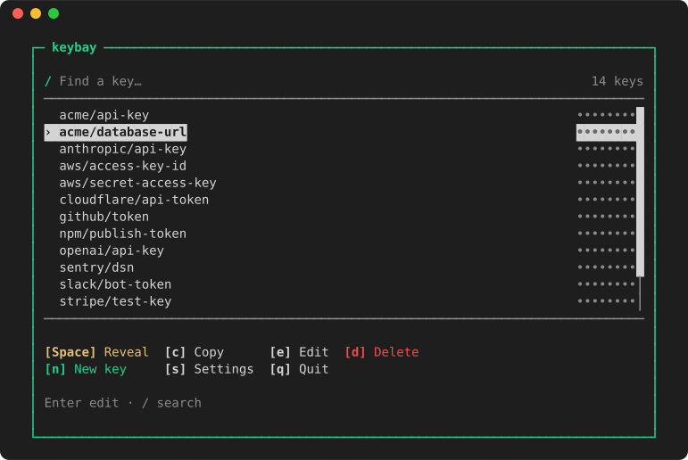
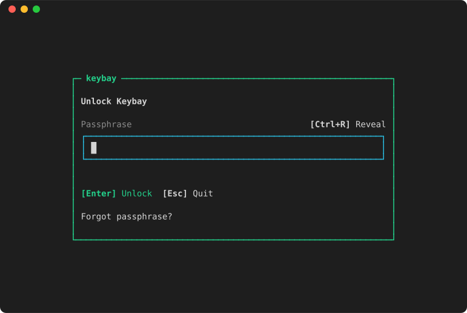
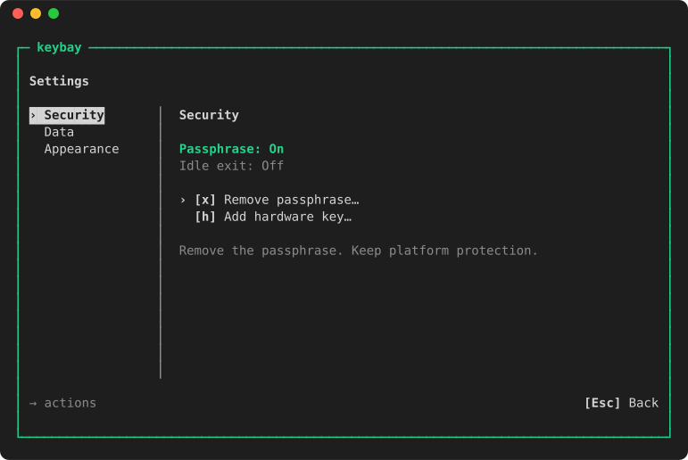

<p align="center">
  
</p>

<h1 align="center">Keybay</h1>

<p align="center">
  <strong>Keep secrets out of Git.</strong><br>
  An encrypted local vault for the terminal and for Dart and Flutter apps,<br>
  protected by your operating system's key store. No account, server or daemon.
</p>

<p align="center">
  <a href="https://pub.dev/packages/keybay"></a>
  <a href="https://github.com/danReynolds/homebrew-tap"></a>
  <a href="LICENSE"></a>
</p>

<p align="center">
  
</p>

<p align="center">
  <a href="https://danreynolds.github.io/keybay/demo/"><strong>Try the terminal UI in your browser</strong></a> ·
  <a href="packages/keybay_cli/README.md">CLI guide</a> ·
  <a href="doc/sdk.md">SDK guide</a> ·
  <a href="doc/security-levels.md">Security levels</a>
</p>

Keybay keeps API keys, tokens and passwords in one encrypted file per
application. The operating system's key store holds the key, so the vault file
reveals nothing on its own, and you can require a passphrase or hardware
security key on top. Use the CLI to commit `kb://` references instead of
secrets, or the Dart SDK as a secure key-value store in your app.

- **Secrets out of your repository.** Commit references in `.env`.
  `keybay run` resolves them and launches your command with ordinary
  environment variables, so it works with any language.
- **A terminal UI for your vault.** `keybay open` lets you search, reveal,
  copy, edit and add protection from the keyboard.
- **OS-backed encryption.** The vault key is sealed by the Keychain on Apple
  platforms, Android Keystore, or the Secret Service keyring on Linux.
- **Passphrases and hardware keys.** Add a passphrase, FIDO2 security keys such
  as a YubiKey, or system passkeys. Any one unlocks the vault, and the platform
  key is always required as well.
- **One Dart API on four platforms.** iOS, Android, macOS and Linux, from Flutter
  or plain Dart, with no Flutter dependency.
- **Local only.** No account, sync, network access or background process.
  Keybay fails closed rather than falling back to weaker storage.

## Install

| For | Install with |
| --- | --- |
| CLI on macOS (Apple silicon) or Linux (x64, ARM64) | `brew install danReynolds/tap/keybay` |
| CLI without Homebrew | [Release archives](https://github.com/danReynolds/keybay/releases/latest), no Dart SDK needed |
| Dart or Flutter app | `dart pub add keybay` or `flutter pub add keybay` |

The Linux CLI needs glibc 2.35+ and an unlocked Secret Service provider, such
as GNOME Keyring or KWallet. The SDK needs Dart 3.11+.

## CLI quick start

Save a secret. Input is hidden and never reaches your shell history:

```sh
keybay set my-app/openai-api-key
```

Reference it from `.env`, which is now safe to commit:

```dotenv
API_URL=https://staging.example.com
OPENAI_API_KEY=kb://my-app/openai-api-key
```

Run your app with the secret injected:

```sh
keybay run -- npm start
```

Keybay resolves every reference before anything launches, then replaces itself
with your command. The child process sees plain environment variables and
needs no Keybay library. If a reference is missing, nothing launches and Keybay
says how to fix it:

```console
$ keybay run -- npm start
warning: platform protection only; no additional credential is configured.
error: 1 of 1 reference in "./.env" is not set on this machine:

  keybay set my-app/openai-api-key

Nothing was launched.
```

| Command | What it does |
| --- | --- |
| `keybay open` | Open the interactive vault. |
| `keybay set KEY` | Save a value from hidden input, or from a pipe with `--stdin`. |
| `keybay run [-f FILE] -- COMMAND` | Launch a command with the manifest's references resolved. |
| `keybay get KEY` | Print one value to your terminal. Pipes and redirects are refused. |
| `keybay list` | List key names. |
| `keybay rm KEY` | Delete a key. |

Moving a secret from another tool works without it ever appearing on screen:

```sh
op read 'op://Engineering/OpenAI/credential' | keybay set --stdin my-app/openai-api-key
```

## The terminal UI

`keybay open` is a keyboard-driven vault. Search names with `/`, reveal one
value with Space, copy with `c`, and create, edit or delete with `n`, `e` and
`d`. Values stay masked until you ask, and resizing the terminal or switching
away hides them again. Settings (`s`) is where you add or remove a passphrase
and hardware keys, clear or reset the vault, and pick an accent color.

<table>
  <tr>
    <td width="50%"></td>
    <td width="50%"></td>
  </tr>
  <tr>
    <td align="center">Unlock with a passphrase or hardware key</td>
    <td align="center">Manage protection in Settings</td>
  </tr>
</table>

The [browser demo](https://danreynolds.github.io/keybay/demo/) runs the same
interface against fake records, so you can try it before installing.

## Dart and Flutter

```dart
import 'package:keybay/keybay.dart';

final session = await Keybay.open();
try {
  await session.set('api-token', token);
  final saved = await session.get('api-token');
} finally {
  await session.close();
}
```

Each application gets its own vault, tied to its platform identity. Reading
and writing never prompt. To require a passphrase or passkey, enroll it from an
open session:

```dart
final passphrase = PassphraseCredential(phrase: utf8.encode(input)); // dart:convert
await session.auth.add(passphrase);
```

From then on, open the vault with that credential:

```dart
final session = await Keybay.open(credential: passphrase);
```

Hardware keys use `PasskeyCredential.hardware(...)` and platform passkeys use
`PasskeyCredential.system(...)`, through the same two calls. Plain Dart
executables on macOS and Linux declare an application ID in `pubspec.yaml` and
compile with `dart run keybay:keybay_compile`. The [SDK guide](doc/sdk.md)
covers native setup, errors and recovery, and
[Keybay Demo](apps/keybay_demo/README.md) is a small Flutter app built on the
SDK for iOS, Android and macOS.

## Supported platforms

| Platform | Dart SDK | CLI | Platform key held by | Security class |
| --- | :---: | :---: | --- | --- |
| iOS | ✓ | | Data Protection Keychain | App-bound |
| Android 12+ | ✓ | | Android Keystore | App-bound |
| macOS app with a Keychain entitlement | ✓ | | Data Protection Keychain | App-bound |
| macOS, unentitled app or executable | ✓ | ✓ Apple silicon | Login Keychain | Account-level |
| Linux desktop | ✓ | ✓ x64, ARM64 | Secret Service: GNOME Keyring or KWallet | Account-level |
| Flatpak | Candidate | | XDG Secret Portal | App-bound against other sandboxed apps |

Windows and Snap are not supported; Keybay refuses to open rather than fall
back to weaker storage.

- **App-bound:** the operating system checks the requesting app's signature or
  package and gives the key to your app alone.
- **Account-level:** programs running as you can reach the key: on macOS once
  you approve a Keychain prompt or by running the app itself, and on Linux
  silently. Add a passphrase or hardware key when that should not be enough.

[Security levels by platform](doc/security-levels.md) spells out who can read
your secrets on each platform, with and without a passphrase or passkey.

## Security model

Two layers protect every vault:

1. **The platform key, always.** The OS key store holds the key that seals the
   vault, so a copy of the file reveals nothing and other user accounts are
   kept out.
2. **Methods, optionally.** A passphrase (stretched with Argon2id), a FIDO2
   hardware key or a system passkey. With one enrolled, opening the vault needs
   the platform key *and* one method.

The vault is encrypted with XChaCha20-Poly1305. Each method also confirms the
vault it opens, so someone holding only the platform key cannot substitute a
vault that your passphrase or passkey would accept. Keybay 0.3.0 added that
check ([GHSA-2cm6-3f6q-5jqc](https://github.com/danReynolds/keybay/security/advisories/GHSA-2cm6-3f6q-5jqc)).

Administrator or root access, malware running inside your app or reading your
keystrokes, and whatever a launched process does with the secrets it receives
are out of scope. Read more:

- [Architecture](doc/architecture.md): how the vault, its keys and protection
  changes work.
- [Security design](doc/design.md): the threat model and numbered invariants.
- [Security policy](SECURITY.md): guarantees, limitations and how to report a
  vulnerability privately.
- [Verifying a CLI download](packages/keybay_cli/README.md#verify-a-release-download).

## When to use something else

Keybay stores values on one device for one person. If you need to share secrets
with a team, deliver them to CI or production, or run on Windows, a hosted
secrets manager or an encrypted-file tool fits better.
[Choosing Keybay](doc/ecosystem-comparison.md) compares it with 1Password CLI,
dotenvx, SecretSpec and flutter_secure_storage.

## Status

Keybay is pre-1.0, and APIs and the vault format may change between minor
versions. If a 0.2.0 vault has a passphrase or passkey, remove them with 0.2.0
before upgrading to 0.3.0, then add them back; see the
[changelog](packages/keybay/CHANGELOG.md#030). Device and provider coverage is
recorded in [release readiness](doc/release-readiness.md).

## License

[MIT](LICENSE)
