<p align="center">
  
</p>

<h1 align="center">Keybay</h1>

<p align="center">
  <strong>Keep secrets out of Git.</strong><br>
  An encrypted vault on your machine for API keys and tokens.<br>
  Use it from the terminal or from your Dart and Flutter apps.
</p>

<p align="center">
  <a href="https://pub.dev/packages/keybay"></a>
  <a href="https://github.com/danReynolds/keybay/actions/workflows/ci.yml"></a>
  <a href="LICENSE"></a>
</p>

<p align="center">
  <a href="https://danreynolds.github.io/keybay/demo/"><strong>Try it in your browser</strong></a> ·
  <a href="#install">Install</a> ·
  <a href="#quick-start">Quick start</a> ·
  <a href="#platforms-and-security">Platforms and security</a> ·
  <a href="#learn-more">Learn more</a>
</p>

<p align="center">
  <a href="https://danreynolds.github.io/keybay/demo/"></a>
</p>

Keybay runs on macOS and Linux, plus iOS and Android for the SDK. Your OS
keychain protects the vault, a passphrase or hardware key (like a YubiKey) can
lock it further, and Keybay never uses the network.

| Tool | What it does | Learn more |
| --- | --- | --- |
| **`keybay run`** | Runs your app with secrets from your vault, so `.env` doesn't hold them. | [CLI guide](packages/keybay_cli/README.md) |
| **`keybay open`** | A terminal UI to browse, edit and protect your secrets. | [Try it in your browser](https://danreynolds.github.io/keybay/demo/) |
| **`package:keybay`** | Encrypted storage for Dart and Flutter apps. | [SDK guide](doc/sdk.md) |

## Install

### CLI and terminal UI

```sh
brew install danReynolds/tap/keybay
```

Homebrew works on Apple silicon Macs and on Linux x64 and arm64; update with
`brew upgrade keybay`. There's no Intel Mac build. You can also:

- **Download a release.** Get the `macos-arm64`, `linux-x64` or `linux-arm64`
  archive from the
  [latest release](https://github.com/danReynolds/keybay/releases/latest) and
  extract it. From the extracted folder, run `./keybay` on macOS or
  `./bin/keybay` on Linux. Keep the folder together; no Dart SDK is needed.
  [Verify the download](packages/keybay_cli/README.md#verify-a-release-download).
- **Build from source** for development. See
  [development builds](packages/keybay_cli/README.md#development-builds).

On Linux, the CLI needs glibc 2.35+ (Ubuntu 22.04 or newer, for example) and a
desktop keyring such as GNOME Keyring or KWallet that's already unlocked.
Keybay won't unlock or create one, so it doesn't run on headless servers or in
CI.

### Dart and Flutter SDK

```sh
dart pub add keybay      # or: flutter pub add keybay
```

Most platforms need a one-time setup step, covered in the
[SDK guide](doc/sdk.md).

## Quick start

### CLI

Save a secret. You type the value into a hidden prompt:

```sh
keybay set my-app/openai-api-key
```

Prefixes like `my-app/` just organize names; all your projects share one CLI
vault.

Point `.env` at the secret instead of pasting it:

```diff
-OPENAI_API_KEY=sk-live-…
+OPENAI_API_KEY=kb://my-app/openai-api-key
```

Then run your app through Keybay from the folder with `.env` (or name another
file with `-f`):

```sh
keybay run -- npm start
```

Your app gets the real value as an ordinary environment variable, so any
language works. Only run commands and `.env` files you trust.

Next steps:

- Browse and edit your secrets with `keybay open`.
- Add a passphrase or hardware key in `keybay open` → Settings. Until you do,
  commands that read or write secrets print a reminder.
- See every command with `keybay --help`.

### Dart and Flutter

```dart
import 'package:keybay/keybay.dart';

final session = await Keybay.open();
try {
  await session.set('api-token', token);
  final saved = await session.get('api-token');
} finally {
  await session.close();
}
```

Each app gets its own vault. The [SDK guide](doc/sdk.md) covers adding a
passphrase or passkey with `session.auth.add`, and handling errors.

## Platforms and security

| Platform | SDK | CLI | Other apps kept out? |
| --- | :---: | :---: | --- |
| iOS | ✓ | | Yes |
| Android 12+ | ✓ | | Yes |
| macOS app with Keychain entitlement | ✓ | | Yes |
| macOS CLI and other macOS apps | ✓ | ✓ | No: add a passphrase or hardware key |
| Linux desktop | ✓ | ✓ | No: add a passphrase or hardware key |

**Yes** means the OS gives the vault's key only to your app. **No** means other
programs on your account can get it: on Linux, any that can reach your unlocked
keyring; on macOS, any that can run `keybay` or your app, or that you allow at a
Keychain prompt. Windows, web and Snap aren't supported.

> [!TIP]
> On a **No** platform, add a passphrase or a hardware key such as a YubiKey,
> and other programs need it too. Use `keybay open` → Settings in the CLI, or
> `session.auth.add` in the SDK.

Everywhere, a copied vault file is useless without your OS keychain. Keybay
can't protect against root access, keyloggers, code running inside your app, or
what your apps do with a secret once they have it. It's pre-1.0 and hasn't had
an independent security audit.

More in [security levels by platform](doc/security-levels.md), the
[security policy](SECURITY.md) and the [architecture](doc/architecture.md).

## Learn more

- [CLI guide](packages/keybay_cli/README.md): every command, the `.env` format,
  the terminal UI and verifying downloads.
- [SDK guide](doc/sdk.md): setup for each platform, passkeys, errors and
  recovery.
- [Choosing Keybay](doc/ecosystem-comparison.md): Keybay is for one person on
  one machine. For teams, use 1Password CLI or dotenvx; for CI, your CI's
  secret store.
- [Keybay Demo](apps/keybay_demo/README.md): a small Flutter app built on the
  SDK.
- Upgrading a 0.2.0 vault with a passphrase or hardware key? Follow the
  [CLI](packages/keybay_cli/README.md#install) or
  [SDK](packages/keybay/CHANGELOG.md#030) steps first.

Issues and pull requests are welcome. Report vulnerabilities privately through
[SECURITY.md](SECURITY.md). Keybay is [MIT licensed](LICENSE).
